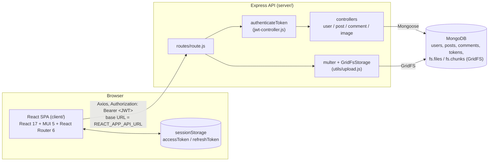

# Alumni Connect – Implementation Guide

This document explains everything needed to understand, run, modify and deploy Alumni Connect using only this repository.

## Contents

1. [Purpose and overview](#1-purpose-and-overview)
2. [Architecture](#2-architecture)
3. [Folder and file structure](#3-folder-and-file-structure)
4. [Tech stack and versions](#4-tech-stack-and-versions)
5. [Data models](#5-data-models)
6. [API reference](#6-api-reference)
7. [Authentication and role logic](#7-authentication-and-role-logic)
8. [Client pages, components and routing](#8-client-pages-components-and-routing)
9. [Seed script and sample data](#9-seed-script-and-sample-data)
10. [Environment variables](#10-environment-variables)
11. [Setup from a clean machine](#11-setup-from-a-clean-machine)
12. [Running locally](#12-running-locally)
13. [Deployment guide](#13-deployment-guide)
14. [Verification steps and results](#14-verification-steps-and-results)
15. [Troubleshooting](#15-troubleshooting)
16. [Limitations and next steps](#16-limitations-and-next-steps)

---

## 1. Purpose and overview

Alumni Connect connects the graduates (alumni) of an institute with its current students.

- **Alumni** publish posts: interview experiences, career advice, job/internship openings.
- **Students** read those posts, filter them by company or job title, comment, and can publish their own posts (e.g. asking for guidance).
- Every user has exactly one **role**: `alumni` or `student`, selected at signup.
- Every post can carry two **tags**: `company` (e.g. "Google") and `role` (job title, e.g. "Software Engineer"). The home page lets users filter on both.

Core capabilities: signup/login with JWT, role badges, profile pages, create/edit/delete posts with an optional cover image, categories, company/role tags and filters, comments, and an idempotent seed script.

---

## 2. Architecture



Request flow:

1. The React app calls the API through a single Axios instance (`client/src/service/api.js`) whose base URL comes from `REACT_APP_API_URL`.
2. Protected routes pass through `authenticateToken`, which verifies the JWT and puts the decoded payload (`_id`, `name`, `username`, `role`) on `request.user`.
3. Controllers read/write MongoDB through Mongoose models. Uploaded images are stored in GridFS and served back by `GET /file/:filename`.

---

## 3. Folder and file structure

```
Blog-Website/
├── .gitignore                    Root ignore: node_modules, .env*, client/build
├── README.md                     Project summary and quick start
├── IMPLEMENTATION.md             This document
├── server/
│   ├── .env.example              Env var names with placeholder values
│   ├── .gitignore                Ignores node_modules and .env*
│   ├── package.json              Scripts: start, dev, seed
│   ├── index.js                  Loads env, configures CORS/body parsing, mounts routes, connects DB, listens on PORT
│   ├── seed.js                   Idempotent sample data (users + posts)
│   ├── database/
│   │   └── db.js                 getMongoURL() (MONGODB_URI or legacy DB_USERNAME/DB_PASSWORD) + Connection()
│   ├── model/
│   │   ├── user.js               User schema (role, graduationYear, currentCompany, currentRole) + USER_ROLES
│   │   ├── post.js               Post schema (company, role, authorRole, categories, ...)
│   │   ├── comment.js            Comment schema
│   │   ├── category.js           Category schema (defined, not used by any route)
│   │   └── token.js              Stored refresh tokens
│   ├── controller/
│   │   ├── user-controller.js    validateSignup, signup, login, getUserProfile, logout
│   │   ├── jwt-controller.js     authenticateToken middleware (401), token payload, refresh-token endpoint
│   │   ├── post-controller.js    CRUD (author-only update/delete) + filtered list
│   │   ├── comment-controller.js Comment create/list/delete (author-only delete)
│   │   └── image-controller.js   Upload response URL + GridFS streaming
│   ├── routes/
│   │   └── route.js              All HTTP routes
│   └── utils/
│       └── upload.js             Multer GridFS storage, image type/size checks, JSON upload errors
└── client/
    ├── .env.example              REACT_APP_API_URL, REACT_APP_CONTACT_EMAIL
    ├── .gitignore                Ignores node_modules, build, .env*
    ├── package.json              Scripts: start, build, test
    ├── vercel.json               SPA rewrite for Vercel
    ├── public/
    │   ├── index.html            Page title "Alumni Connect"
    │   ├── manifest.json         PWA names
    │   └── _redirects            SPA rewrite for Netlify
    └── src/
        ├── index.js              React entry
        ├── App.js                Router + PrivateRoute wrapper
        ├── constants/
        │   ├── config.js         SERVICE_URLS (endpoint map) + notification messages
        │   └── data.js           Post categories
        ├── context/
        │   └── DataProvider.js   Global `account` state { name, username, role }, persisted in sessionStorage
        ├── service/
        │   └── api.js            Axios instance, 401 refresh-and-retry interceptor, generated API.* functions
        ├── utils/
        │   └── common-utils.js   Token helpers, request-type helper
        └── components/
            ├── account/Login.jsx         Login + signup (role selection, role-specific fields)
            ├── header/Header.jsx         Nav links, PROFILE link, own role badge
            ├── banner/Banner.jsx         Home hero banner
            ├── home/Home.jsx             Banner + categories + filters + posts
            ├── home/Categories.jsx       "Create Post" button + category list
            ├── home/Filters.jsx          Company / role filter bar (URL query params)
            ├── home/post/Posts.jsx       Fetches and renders the post grid
            ├── home/post/Post.jsx        Post card (role badge + company/role tags)
            ├── create/CreatePost.jsx     New post form (title, company, role, body, image)
            ├── create/Update.jsx         Edit post form
            ├── details/DetailView.jsx    Post detail (tags link to filters, author → profile)
            ├── details/comments/*.jsx    Comment list and item
            ├── profile/Profile.jsx       User profile + their posts
            ├── common/RoleBadge.jsx      Alumni / Student chip
            ├── common/PostTags.jsx       Company / role chips (optionally links)
            ├── about/About.jsx           About the platform
            └── contact/Contact.jsx       Contact page (email from REACT_APP_CONTACT_EMAIL)
```

---

## 4. Tech stack and versions

Versions are those installed from the lockfiles.

**Server** (`server/package.json`, ES modules, `"type": "module"`)

| Package | Version | Use |
|---------|---------|-----|
| express | 4.18.1 | HTTP server and routing |
| mongoose | 6.3.4 (driver mongodb 4.5.0) | MongoDB ODM |
| jsonwebtoken | 8.5.1 | Access / refresh tokens |
| bcrypt | 5.0.1 | Password hashing (10 salt rounds) |
| cors | 2.8.5 | CORS with `CORS_ORIGIN` allow-list |
| dotenv | 16.0.1 | Loads `server/.env` |
| body-parser | 1.20.0 | JSON / urlencoded bodies |
| multer | 1.4.4 | Multipart uploads |
| multer-gridfs-storage | 5.0.2 | Stores uploads in GridFS |
| gridfs-stream | 1.1.1 | GridFS file lookup |
| nodemon | 2.0.16 | Dev auto-reload (`npm run dev`) |

**Client** (`client/package.json`, Create React App)

| Package | Version | Use |
|---------|---------|-----|
| react / react-dom | 17.0.2 | UI |
| react-router-dom | 6.3.0 | Routing |
| @mui/material, @mui/icons-material | 5.8.0 | Components and icons |
| @emotion/react, @emotion/styled | 11.x | MUI styling engine |
| axios | 0.21.1 | HTTP client |
| react-scripts | 4.0.3 | Build tooling (webpack 4) |
| typescript (dev) | 4.9.5 | Pinned so CRA 4's ESLint TypeScript plugin loads (see Troubleshooting) |

Runtime: tested with Node.js 24.11.1 / npm 11.6.2. The client `start`/`build` scripts pass `--openssl-legacy-provider` to Node because webpack 4 uses a hash algorithm OpenSSL 3 disables by default.

---

## 5. Data models

All models live in `server/model/`. MongoDB collection names are Mongoose's pluralised lowercase names.

### User (`users`)

| Field | Type | Required | Notes |
|-------|------|----------|-------|
| `name` | String | yes | Display name |
| `username` | String | yes, unique | Login id, used in URLs (`/profile/:username`) |
| `password` | String | yes | bcrypt hash, never returned by the API |
| `role` | String enum `alumni` \| `student` | yes | Exported as `USER_ROLES` |
| `graduationYear` | Number | no | Alumni: year graduated. Student: expected graduation year |
| `currentCompany` | String | no | Alumni only (dropped for students at signup) |
| `currentRole` | String | no | Alumni only – current job title |

### Post (`posts`)

| Field | Type | Required | Notes |
|-------|------|----------|-------|
| `title` | String | yes, unique | |
| `description` | String | yes | Post body |
| `picture` | String | no | URL returned by `/file/upload` |
| `username` | String | yes | Author's username (taken from the JWT, never from the request body) |
| `authorRole` | String | no | Author's role, set by the server from the JWT on create; cannot be changed on update |
| `company` | String (trimmed) | no | Company tag |
| `role` | String (trimmed) | no | Job-title tag (this is the post's role tag, not the user's role) |
| `categories` | Array | no | One of the categories in `client/src/constants/data.js`, or `All` |
| `createdDate` | Date | no | Set by the server on create |

### Comment (`comments`)

| Field | Type | Required | Notes |
|-------|------|----------|-------|
| `name` | String | yes | Commenter's username (from the JWT) |
| `postId` | String | yes | Post `_id` |
| `date` | String | yes | ISO timestamp set by the server |
| `comments` | String | yes | Comment text |

### Token (`tokens`)

| Field | Type | Notes |
|-------|------|-------|
| `token` | String | A refresh token (7-day JWT) issued at login, deleted by `/logout` |

### Category (`categories`)

`name: String` – the schema exists but no route uses it; categories are a static list on the client.

### GridFS (`fs.files`, `fs.chunks`)

Uploaded images (png/jpg/jpeg/gif/webp, max 5 MB). Files are named `<timestamp>-<original name with unsafe characters replaced by _>`.

---

## 6. API reference

Base URL: `http://localhost:8000` locally (or `SERVER_URL` in production).
"Auth" = header `authorization: Bearer <accessToken>`.

Status code conventions:

| Code | Meaning |
|------|---------|
| `400` | Validation error, invalid id, duplicate username/title, bad file type – body `{ "msg": "..." }` |
| `401` | Token missing (`token is missing`), invalid or expired (`invalid token`). The client answers a 401 by refreshing the access token once and retrying |
| `403` | Authenticated but not allowed – editing/deleting someone else's post or comment |
| `404` | Post / comment / user / image not found |
| `413` | Uploaded image larger than 5 MB |
| `500` | Unexpected server/database error – body `{ "msg": "..." }` |

| Method | Path | Auth | Purpose |
|--------|------|------|---------|
| POST | `/signup` | no | Create user |
| POST | `/login` | no | Log in, get tokens |
| POST | `/logout` | no | Delete a refresh token |
| POST | `/token` | no | New access token from a refresh token |
| GET | `/user/:username` | yes | Public profile |
| POST | `/create` | yes | Create post |
| PUT | `/update/:id` | yes, author only | Update post |
| DELETE | `/delete/:id` | yes, author only | Delete post |
| GET | `/post/:id` | yes | Get one post |
| GET | `/posts` | yes | List/filter posts |
| POST | `/file/upload` | yes | Upload image (multipart field `file`, png/jpg/jpeg/gif/webp, max 5 MB) |
| GET | `/file/:filename` | no | Stream an uploaded image (public so `` tags work) |
| POST | `/comment/new` | yes | Add comment |
| GET | `/comments/:id` | yes | Comments for post `:id` |
| DELETE | `/comment/delete/:id` | yes, author only | Delete comment |

### POST /signup

```json
{
  "name": "Priya Sharma",
  "username": "priya.sharma",
  "password": "secret",
  "role": "alumni",
  "graduationYear": 2019,
  "currentCompany": "Google",
  "currentRole": "Software Engineer"
}
```

Validation (`validateSignup` in `user-controller.js`):

- `name`, `username`, `password` required → else `400 {"msg":"Name, username and password are required"}`
- `role` must be `alumni` or `student` → else `400 {"msg":"Role must be one of: alumni, student"}`
- `graduationYear` optional; if present must be an integer between 1950 and current year + 10; alumni: not in the future; student: not in the past.
- `currentCompany` / `currentRole` are kept only for alumni.
- Duplicate username → `400 {"msg":"Username is already taken"}`

Success: `200 {"msg":"Signup successfull"}`

### POST /login

Request: `{ "username": "priya.sharma", "password": "Alumni@123" }`

Response `200`:

```json
{
  "accessToken": "<jwt, 15 min>",
  "refreshToken": "<jwt, 7 days>",
  "name": "Priya Sharma",
  "username": "priya.sharma",
  "role": "alumni",
  "graduationYear": 2019,
  "currentCompany": "Google",
  "currentRole": "Software Engineer"
}
```

Errors: `400 {"msg":"Username does not match"}`, `400 {"msg":"Password does not match"}`.

JWT payload (both tokens): `{ "_id", "name", "username", "role", "iat", "exp"? }`. The password hash is not included.

### POST /logout

Request: `{ "token": "<refresh token>" }` (with or without the `Bearer ` prefix) → `204`. The refresh token is deleted, so it can no longer be used at `/token`. Called by the header's LOGOUT link.

### POST /token

Request: `{ "token": "Bearer <refresh token>" }` → `200 { "accessToken": "..." }` (a fresh 15-minute token with payload `{_id, name, username, role}`).
Missing token, token not in the `tokens` collection (e.g. after logout), or invalid/expired refresh token → `401`. Used automatically by the client when a request returns 401.

### GET /user/:username

Response `200` (alumni example):

```json
{ "_id": "...", "name": "Priya Sharma", "username": "priya.sharma", "role": "alumni",
  "graduationYear": 2019, "currentCompany": "Google", "currentRole": "Software Engineer" }
```

Student example: `{ "_id": "...", "name": "Test Student", "username": "t.student", "role": "student", "graduationYear": 2028 }`
Unknown user: `404 {"msg":"User not found"}`.

### POST /create

```json
{
  "title": "Amazon is hiring Data Science interns",
  "description": "...",
  "picture": "http://localhost:8000/file/1700000000000-cover.png",
  "company": "Amazon",
  "role": "Data Science Intern",
  "categories": "Job Openings"
}
```

Only `title`, `description`, `picture`, `company`, `role`, `categories` are read from the body. `username` and `authorRole` come from the token and `createdDate` is set by the server, so values sent for them are ignored. `save()` is awaited:

- `200 "Post saved successfully"`
- `400 {"msg":"A post with this title already exists"}`
- `400 {"msg":"post validation failed: description: Path `description` is required."}` (missing required fields)

### PUT /update/:id

Body: any of the editable fields above (the client sends the whole post; other fields are ignored).

- Not the author → `403 {"msg":"You can only modify your own posts"}`
- Invalid id → `400`, unknown id → `404`, duplicate title → `400`
- Success → `200 "post updated successfully"`

### DELETE /delete/:id

Same ownership/400/404 rules as update. Success → `200 "post deleted successfully"`.

### GET /post/:id

Response: the post document. Invalid id → `400`, unknown → `404`.

### GET /posts – list and filter

| Query param | Match |
|-------------|-------|
| `company` | Case-insensitive partial match on `company` (input is regex-escaped) |
| `role` | Case-insensitive partial match on the post's `role` tag |
| `category` | Exact match inside `categories` |
| `username` | Exact author match |

Filters combine with AND; empty values are ignored; results are sorted by `createdDate` descending. Partial matching means `role=Software Engineer` also returns "Software Engineer Intern".

```
GET /posts?company=google
GET /posts?role=intern
GET /posts?company=amazon&role=scientist&category=Interview%20Experience
```

### POST /file/upload

Requires auth. `multipart/form-data` with field `file`; one file; mimetype must be `image/png`, `image/jpeg`, `image/jpg`, `image/gif` or `image/webp` **and** the name must end in `.png/.jpg/.jpeg/.gif/.webp`.

- Success → `200 "<SERVER_URL>/file/<timestamp>-<sanitised name>"` (a JSON string)
- No token → `401`; wrong type → `400 {"msg":"Only png, jpg, jpeg, gif or webp images are allowed"}`; over 5 MB → `413 {"msg":"Image must be 5 MB or smaller"}`; no file → `400 {"msg":"No image file provided"}`

### GET /file/:filename

Streams the image from GridFS with its stored `Content-Type`. Unknown file → `404`.

### Comments

- `POST /comment/new` body `{ "postId": "<post id>", "comments": "text" }` → `200 "Comment saved successfully"`. `name` is the token user's username and `date` is set by the server (body values ignored). Empty text → `400`; unknown post → `404`.
- `GET /comments/:postId` → array of comments
- `DELETE /comment/delete/:id` → `200 "comment deleted successfully"`; someone else's comment → `403 {"msg":"You can only delete your own comments"}`; unknown → `404`

---

## 7. Authentication and role logic

### Tokens

- On login the server signs an **access token** (`ACCESS_SECRET_KEY`, 15 minutes) and a **refresh token** (`REFRESH_SECRET_KEY`, 7 days, stored in the `tokens` collection). Both carry `{ _id, name, username, role }`.
- The client stores both in `sessionStorage` as `Bearer <token>` and sends the access token in the `authorization` header on every request (`service/api.js`).
- `authenticateToken` verifies the access token and sets `request.user`. Missing/invalid/expired → `401`.
- **Refresh flow** (`service/api.js` response interceptor): on a `401` the client calls `POST /token` with the refresh token (concurrent 401s share one refresh call), stores the new access token and retries the original request once. If the refresh fails, `sessionStorage` is cleared and the browser goes to `/account`.
- `403` means "authenticated but not allowed" and is shown to the user as an error; it never logs the user out.
- **Logout** (header LOGOUT): calls `POST /logout` to revoke the refresh token, clears `sessionStorage` and the account context, and navigates to `/account`.

### Authorization (ownership)

- Post `username` / `authorRole` and comment `name` always come from the token.
- Update/delete of posts and delete of comments compare the stored author with `request.user.username` and return `403` otherwise.
- The UI also hides edit/delete controls from non-authors, and `/update/:id` shows "You can only edit your own posts." for someone else's post.

### Session on the client

- `DataProvider` holds `account = { name, username, role }`, filled from the login response and mirrored to `sessionStorage.account`.
- On page load the account is restored from `sessionStorage`, and `App.js` starts with `isAuthenticated = true` when both an access token and an account are stored, so a browser refresh keeps the user logged in (within the same tab; `sessionStorage` is per-tab).
- `PrivateRoute` renders a page only if `isAuthenticated` is true **and** an access token exists.

### Alumni vs student

| Aspect | Alumni | Student |
|--------|--------|---------|
| Chosen at | Signup radio buttons ("Alumni" / "Current Student") | same |
| Extra signup fields | Graduation Year, Current Company, Current Role / Job Title | Expected Graduation Year |
| Server rules | year ≤ current year; company/role stored | year ≥ current year; company/role discarded |
| Badge colour | MUI `primary` (blue) "Alumni" | MUI `secondary` (purple) "Student" |
| Profile text | "Class of YYYY", "<role> at <company>" | "Expected graduation: YYYY" |
| Permissions | Create/edit/delete own posts, comment | Same (no role-restricted actions) |

The role is the single source of truth on the server: it is stored on the user, put in the JWT, and stamped on each post as `authorRole` from the token, so a client cannot fake another role on a new post.

---

## 8. Client pages, components and routing

| Route | Component | Description |
|-------|-----------|-------------|
| `/account` | `Login` | Login form; toggle to signup form with role selection |
| `/` | `Home` | Banner, categories, company/role filter bar, post grid. Reads `?category=`, `?company=`, `?role=`, `?username=` |
| `/create` | `CreatePost` | Title, Company, Role / Job title, body, cover image. Category comes from `?category=` (default `All`) |
| `/details/:id` | `DetailView` | Full post; tags link to `/?company=` / `/?role=`; author links to profile; edit/delete for the author |
| `/update/:id` | `Update` | Edit title, company, role, body, image; non-authors see "You can only edit your own posts." |
| `/profile/:username` | `Profile` | Name, role badge, role-specific details, the user's posts |
| `/about` | `About` | What the platform is |
| `/contact` | `Contact` | Contact email (`REACT_APP_CONTACT_EMAIL`, fallback `alumni-office@example.com`) |

All routes except `/account` are wrapped in `PrivateRoute`, which also renders the `Header`.

Key components:

- **Header** – HOME, ABOUT, CONTACT, PROFILE (own profile), LOGOUT (revokes the refresh token and clears the session), and the logged-in user's `RoleBadge`.
- **Filters** – two text fields and Filter/Clear buttons. Submitting writes `company` / `role` into the URL query string (keeping `category`), so filtered views are linkable.
- **Posts** – calls `API.getAllPosts({ category, username, company, role })`; accepts an optional `username` prop (used by `Profile`).
- **Post** – card with image, category, title, author + role badge, company/role chips, excerpt.
- **RoleBadge** – renders nothing for unknown/missing roles (e.g. posts created before roles existed).
- **PostTags** – company (building icon) and role (briefcase icon) chips; `linked` makes them filter links.

API endpoints used by the client are declared in `constants/config.js` (`SERVICE_URLS`); `service/api.js` turns each entry into an `API.<name>()` function.

---

## 9. Seed script and sample data

File: `server/seed.js`, run with `npm run seed` from `server/`.

- Connects with `getMongoURL()` (same logic as the server).
- **Users** are upserted by `username` with `$setOnInsert`; **posts** are upserted by `title` with `$setOnInsert`. Re-running never duplicates or overwrites anything (including edits made in the app).
- Prints how many users/posts were created vs already existed; exits with code 1 on failure.
- Password for all seeded users: `SEED_PASSWORD` or `Alumni@123`.

Users:

| Username | Name | Role | Graduation | Company / Role |
|----------|------|------|------------|----------------|
| priya.sharma | Priya Sharma | alumni | 2019 | Google / Software Engineer |
| rahul.verma | Rahul Verma | alumni | 2016 | Microsoft / Product Manager |
| ananya.iyer | Ananya Iyer | alumni | 2020 | Amazon / Data Scientist |
| arjun.mehta | Arjun Mehta | student | 2027 (expected) | – |
| sneha.reddy | Sneha Reddy | student | 2026 (expected) | – |

Posts:

| Title | Author | Company | Role tag | Category |
|-------|--------|---------|----------|----------|
| How I cracked the Google SWE interview | priya.sharma | Google | Software Engineer | Interview Experience |
| Moving from engineering to product management at Microsoft | rahul.verma | Microsoft | Product Manager | Career Advice |
| Amazon is hiring Data Science interns for summer | ananya.iyer | Amazon | Data Science Intern | Job Openings |
| My Amazon Data Scientist loop: what to expect | ananya.iyer | Amazon | Data Scientist | Interview Experience |
| Resume tips for software roles from a hiring panelist | priya.sharma | Google | Software Engineer | Career Advice |
| Looking for guidance: SDE internship prep at Microsoft | arjun.mehta | Microsoft | Software Engineer Intern | Career Advice |

Posts get `createdDate` values one day apart (newest first) and `authorRole` from their author.

---

## 10. Environment variables

Never commit real values. Templates: `server/.env.example`, `client/.env.example`.

### Server (`server/.env`)

| Name | Required | Meaning |
|------|----------|---------|
| `MONGODB_URI` | yes (recommended) | Full MongoDB connection string, e.g. an Atlas `mongodb+srv://` URI including the database name |
| `DB_USERNAME` | only without `MONGODB_URI` | Username for the legacy Atlas cluster whose hosts are hard-coded in `database/db.js` |
| `DB_PASSWORD` | only without `MONGODB_URI` | Password for that legacy cluster |
| `ACCESS_SECRET_KEY` | yes | Secret for signing/verifying access tokens |
| `REFRESH_SECRET_KEY` | yes | Secret for signing/verifying refresh tokens |
| `PORT` | no | Port to listen on (default 8000). Render injects it automatically |
| `SERVER_URL` | production | Public base URL of the API; used to build image URLs returned by `/file/upload` (default `http://localhost:<PORT>`) |
| `CORS_ORIGIN` | recommended | Comma-separated list of allowed browser origins, e.g. `https://alumni.vercel.app,http://localhost:3000`. Unset = all origins |
| `SEED_PASSWORD` | no | Password given to seeded users (default `Alumni@123`) |

`index.js` imports `dotenv/config` first, so variables are available to every module. Variables already set in the process environment take precedence over `.env`.

### Client (`client/.env`)

| Name | Meaning |
|------|---------|
| `REACT_APP_API_URL` | API base URL without trailing slash. Read at **build time**; rebuild after changing it. Default `http://localhost:8000` |
| `REACT_APP_CONTACT_EMAIL` | Email shown on the Contact page. Build time. Default `alumni-office@example.com` |

---

## 11. Setup from a clean machine

1. Install **Node.js** (18 or newer; tested on 24.11.1) – includes npm.
2. Get a **MongoDB** database:
   - Local: install MongoDB Community Server and use `mongodb://127.0.0.1:27017/alumni`, or
   - Cloud: create a free MongoDB Atlas cluster (see section 13, step 1).
3. Get the code into a folder, e.g. `Blog-Website/`.
4. Backend:
   ```bash
   cd Blog-Website/server
   npm install
   cp .env.example .env     # Windows PowerShell: Copy-Item .env.example .env
   ```
   Edit `.env`: set `MONGODB_URI`, `ACCESS_SECRET_KEY`, `REFRESH_SECRET_KEY` (any long random strings, e.g. `node -e "console.log(require('crypto').randomBytes(32).toString('hex'))"`), and optionally `CORS_ORIGIN=http://localhost:3000`.
5. Frontend:
   ```bash
   cd ../client
   npm install
   cp .env.example .env     # optional
   ```
6. Optional sample data: `cd ../server && npm run seed`.

---

## 12. Running locally

Terminal 1:

```bash
cd server
npm run dev        # or npm start
# -> Server is running successfully on PORT 8000
# -> Database connected successfully
```

Terminal 2:

```bash
cd client
npm start          # opens http://localhost:3000
```

Try it: sign up as a student, or log in as `priya.sharma` / `Alumni@123` after seeding. Filter with Company = `amazon`, open a post and click its company tag, open PROFILE.

Production build of the client: `cd client && npm run build` → static files in `client/build/` (serve with any static host, e.g. `npx serve -s build`).

---

## 13. Deployment guide

Recommended: **MongoDB Atlas** (database) + **Render** (API) + **Vercel or Netlify** (frontend). Nothing in this repo deploys automatically.

### Step 1 – MongoDB Atlas

1. Create an account at mongodb.com/atlas and a free (M0) cluster.
2. *Database Access*: add a database user with a strong password.
3. *Network Access*: add `0.0.0.0/0` (Render's outbound IPs are not fixed on free plans) or Render's static IPs if available on your plan.
4. *Connect → Drivers*: copy the `mongodb+srv://<user>:<password>@<cluster>/...` string, insert the password and a database name, e.g. `.../alumni?retryWrites=true&w=majority`. This is `MONGODB_URI`.

### Step 2 – Backend on Render

1. Push the repository to GitHub/GitLab (make sure `.env` files are not committed – they are git-ignored).
2. Render → *New → Web Service* → connect the repo.
3. Settings:
   - Root Directory: `server`
   - Runtime: Node
   - Build Command: `npm install`
   - Start Command: `npm start`
4. Environment variables: `MONGODB_URI`, `ACCESS_SECRET_KEY`, `REFRESH_SECRET_KEY`, `SERVER_URL` (= the service URL, e.g. `https://alumni-api.onrender.com`), `CORS_ORIGIN` (fill in after step 3; temporarily leave unset to allow all). Do not set `PORT` – Render provides it.
5. Deploy. Logs should show `Server is running successfully on PORT ...` and `Database connected successfully`.
6. Optional seed: Render Shell → `npm run seed` (or run `npm run seed` locally with `MONGODB_URI` pointing at Atlas).

### Step 3a – Frontend on Vercel

1. Vercel → *Add New Project* → import the repo.
2. Root Directory: `client`. Framework preset: Create React App. Build command `npm run build`, output directory `build`.
3. Environment variables: `REACT_APP_API_URL` = Render URL (no trailing slash), optionally `REACT_APP_CONTACT_EMAIL`. (The build passes with `CI=true`, which Vercel sets, because the lint warnings were fixed.)
4. Deploy. `client/vercel.json` rewrites all paths to `index.html` so deep links like `/details/<id>` work.

### Step 3b – Frontend on Netlify (alternative)

1. Netlify → *Add new site → Import an existing project*.
2. Base directory: `client`; build command `npm run build`; publish directory `client/build`.
3. Environment variables: `REACT_APP_API_URL`, optionally `REACT_APP_CONTACT_EMAIL`.
4. `client/public/_redirects` (copied into the build) provides the SPA rewrite.

### Step 4 – Wire them together

1. Set `CORS_ORIGIN` on Render to the frontend URL (e.g. `https://alumni-connect.vercel.app`) and redeploy.
2. If the API URL changes, update `REACT_APP_API_URL` and **rebuild** the frontend.
3. Smoke test: sign up, log in, create a post with company/role, filter, upload an image, refresh the page (still logged in).

---

## 14. Verification steps and results

Run on Windows 11, Node 24.11.1, npm 11.6.2. All runtime tests used a throwaway in-memory MongoDB 5.0.19 (`mongodb-memory-server`, outside the repo) at `mongodb://127.0.0.1:27999/alumni_test`, with dummy secrets passed on the command line – no `.env` file and no real database were used:

```bash
MONGODB_URI=mongodb://127.0.0.1:27999/alumni_test npm run seed
MONGODB_URI=mongodb://127.0.0.1:27999/alumni_test PORT=8123 ACCESS_SECRET_KEY=test_access \
  REFRESH_SECRET_KEY=test_refresh CORS_ORIGIN=http://localhost:3000 SERVER_URL=http://localhost:8123 node index.js
```

### Build and seed

| Step | Command | Result |
|------|---------|--------|
| Server deps | `cd server && npm install` | added 298 packages |
| Client deps | `cd client && npm install` | added 1993 packages |
| Syntax check | `node --check` on every server `.js` file | no errors |
| Seed (run 1) | `npm run seed` | `Users: 5 created, 0 already existed` / `Posts: 6 created, 0 already existed` |
| Seed (run 2) | same | `Users: 0 created, 5 already existed` / `Posts: 0 created, 6 already existed` (5 users, 6 posts in DB) |
| Client build | `npm run build` and `CI=true npm run build` | `Compiled successfully.` (no warnings) |
| API URL env | `REACT_APP_API_URL=https://api.example.com npm run build` | URL present in bundle, `localhost:8000` absent |

### API tests – 45 passed, 0 failed

Scripted with Node `fetch` against the running API:

| Area | Checks (all passed) |
|------|---------------------|
| Signup | no role → 400; non-string username → 400; student signup → 200 (company stripped); duplicate → 400 |
| Login / tokens | role in response and JWT, no password in payload; refresh token `exp - iat` = 7 days |
| Auth | no token → 401; expired access token → 401; `/token` with valid refresh → new token that works; bad/missing refresh → 401; refresh after logout → 401; logout → 204 |
| Filters | `company=google` → 2; `role=intern` → 2; company+role+category → 1; `company=.*` → 0 |
| Posts | create → 200 with spoofed `username`/`authorRole` ignored (stored as token user); duplicate title → 400; missing description → 400; **non-author update → 403; non-author delete → 403**; author update → 200 (owner/role unchanged); unknown id → 404; malformed id → 400; author delete → 200 |
| Comments | create → 200 with `name` from token; empty → 400; unknown post → 404; **non-author delete → 403**; author delete → 200 |
| Uploads | **no token → 401; `.txt` → 400; `.svg` → 400**; 6 MB png → 413; no file → 400; png → 200 URL; image served as `image/png`; unknown image → 404 |
| Profile / CORS | student profile has no company fields; `Access-Control-Allow-Origin: http://localhost:3000` |

### Browser test (Playwright, headed Google Chrome, fresh profile) – 28 of 28 steps passed

Client dev server (`npm start` with `REACT_APP_API_URL=http://localhost:8123`) against the API above:

1. Login page renders (Alumni Connect branding)
2. Signup without choosing a role → "Please choose whether you are an alumnus or a current student"
3. Alumni signup form shows Graduation Year, Current Company, Current Role
4. Alumni signup succeeds → back to login
5. Student signup form shows only "Expected Graduation Year"
6. Student signup succeeds
7. Student with a past year → "Expected graduation year cannot be in the past"
8. Wrong password → "Password does not match"
9. Login → home shows the 6 seeded posts with company/role chips; header shows Alumni badge
10. Filter Company = amazon → 2 posts (URL `?company=amazon`)
11. + Role = intern → 1 post
12. Clear, then Role = product → 1 post
13. Seeded post detail: tags, Alumni badge, no edit/delete icons for a non-author
14. Clicking the "Software Engineer" tag → home filtered by role (3 posts, partial match)
15. Non-author opening `/update/<id>` → "You can only edit your own posts."
16. Uploading a `.txt` file on Create Post → "Only png, jpg, jpeg, gif or webp images are allowed"
17. Create Post with title, Company, Role and a PNG cover → preview shows the uploaded image
18. Publish → new card on home with tags and the uploaded image loaded
19. Own post detail shows edit/delete; adding a comment works
20. Edit own post (title + role) → detail shows new title and role tag
21. Own profile: "Class of 2018", "Senior Engineer at Adobe", the new post
22. Browser reload on the profile → still logged in, badge restored
23. Access token replaced with an invalid one + reload → `POST /token` called, request retried, posts loaded
24. Student profile (`arjun.mehta`): Student badge, "Expected graduation: 2027"
25. Delete own post → removed from home
26. Contact page shows `alumni-office@example.com`; no Instagram/original-author links in the page
27. Logout → session cleared, `/` redirects to `/account`
28. Student login → header shows Student badge

Console output during the browser run: expected 400/401/404 responses from the negative tests and the initial comments fetch, and a React "unknown prop `rowsMin`" warning from MUI's `TextareaAutosize` (the prop is now called `minRows`; cosmetic).

Not verified: a real MongoDB Atlas cluster, an actual Render/Vercel/Netlify deployment, browsers other than Chrome, mobile layouts.

---

## 15. Troubleshooting

| Symptom | Cause / fix |
|---------|-------------|
| `error:0308010C:digital envelope routines::unsupported` during client build | webpack 4 on Node 17+. The `start`/`build` scripts already pass `--openssl-legacy-provider`; make sure you use `npm start` / `npm run build`, not `react-scripts` directly. |
| `Environment key "jest/globals" is unknown` / `Cannot read properties of undefined (reading 'Undefined')` | A TypeScript 5+/7 install breaks CRA 4's `@typescript-eslint` plugin. `typescript@4.9.5` is pinned in `client` devDependencies; run `npm install` again. |
| Build fails on a host with "Treating warnings as errors" | A newly introduced lint warning; fix it, or set `CI=false` in the host's environment as a stop-gap. |
| `Error while connecting to the database` | Check `MONGODB_URI`, Atlas network access (IP allow-list) and user password (URL-encode special characters). |
| Browser shows CORS error | Add the exact frontend origin (scheme + host, no trailing slash) to `CORS_ORIGIN` and restart the API. |
| Requests go to `localhost:8000` in production | `REACT_APP_API_URL` was not set at build time; set it and rebuild. |
| Sent back to the login page unexpectedly | The refresh token was rejected (expired after 7 days, revoked by logout, or `REFRESH_SECRET_KEY` changed). Log in again. |
| Logged out when opening the site in a new tab | Expected: `sessionStorage` is per tab. |
| "You can only modify your own posts" / 403 | Only the author can edit or delete a post or comment. |
| Image upload rejected | Only png/jpg/jpeg/gif/webp up to 5 MB are accepted, and you must be logged in. |
| Deep link returns 404 on the static host | Ensure `client/vercel.json` (Vercel) or `public/_redirects` (Netlify) is deployed. |
| Uploaded images point to `localhost` | Set `SERVER_URL` on the API to its public URL. |
| Signup returns "Expected graduation year cannot be in the past" | Students must enter the current or a future year; alumni the current or a past year. |
| `npm run seed` hangs or fails | Same as database connection issues; the script prints `Seeding failed: <message>` and exits with code 1. |

---

## 16. Limitations and next steps

### Fixed in this version

| Previously | Now |
|------------|-----|
| Any logged-in user could update/delete any post or comment | Author-only: server compares the stored author with the token user and returns `403` |
| Post `username` and comment `name` came from the request body | Both come from the JWT; `authorRole` and `createdDate` are also server-set |
| `POST /file/upload` was public and accepted any file (`memeType` typo meant the type check never ran) | Requires auth; png/jpg/jpeg/gif/webp only (mimetype + extension), 5 MB limit, JSON `400`/`413` errors; filenames sanitised |
| `save()` not awaited – duplicate titles/validation errors were silently lost | Awaited; `400` with a message for duplicates/validation, `404` for unknown ids, `500` with a message otherwise |
| Expired tokens returned `403` and silently cleared the session | Expired/invalid tokens return `401`; the client refreshes the access token via `/token` and retries; `403` now only means "not allowed" |
| Refresh tokens never expired; `/token` could crash and minted already-expired tokens | Refresh tokens last 7 days; `/token` validates input, returns `401` on failure and issues a fresh 15-minute token |
| LOGOUT only navigated away | LOGOUT revokes the refresh token server-side and clears the session |
| Login lost on browser refresh | Account restored from `sessionStorage` on load |
| Contact page email was hard-coded | Contact email comes from `REACT_APP_CONTACT_EMAIL` |
| Signup inputs switched between controlled/uncontrolled (overlapping labels) | Signup inputs are controlled |
| Client build needed `CI=false` | Lint warnings fixed; `CI=true npm run build` compiles cleanly |

### Remaining limitations

- `GET /file/:filename` is public (needed for `` tags); anyone with the URL can view an uploaded image.
- Tokens are stored in `sessionStorage` (readable by any script on the page); a new tab requires logging in again. HttpOnly cookies would be stronger.
- No rate limiting on `/login` and `/signup`; no password strength rules.
- `database/db.js` keeps a fallback to a hard-coded legacy Atlas cluster when `MONGODB_URI` is not set; prefer `MONGODB_URI`.
- Company/role tags are free text, so "Google" and "Google LLC" are different tags; filtering is substring-based to soften this.
- Posts created before roles existed have no `authorRole`, `company` or `role`; they show no badge or tags.
- Deleting a post leaves its comments and image in the database.
- MUI warns about the legacy `rowsMin` prop on `TextareaAutosize` (cosmetic).
- Client uses Create React App 4 (unmaintained) and the default `App.test.js` is outdated.

### Suggested next steps

1. Move tokens to HttpOnly cookies and add rate limiting (e.g. `express-rate-limit`) on auth routes.
2. Cascade-delete comments and images when a post is deleted.
3. Normalise company names (autocomplete from distinct values via a `GET /companies` endpoint).
4. Role-specific features: "Open to referrals" flag for alumni, "Looking for" interests for students, alumni directory page.
5. Migrate the client to Vite or CRA 5.
6. Turn the API and Playwright checks from section 14 into automated tests (Jest + Supertest with `mongodb-memory-server`, Playwright test runner).
