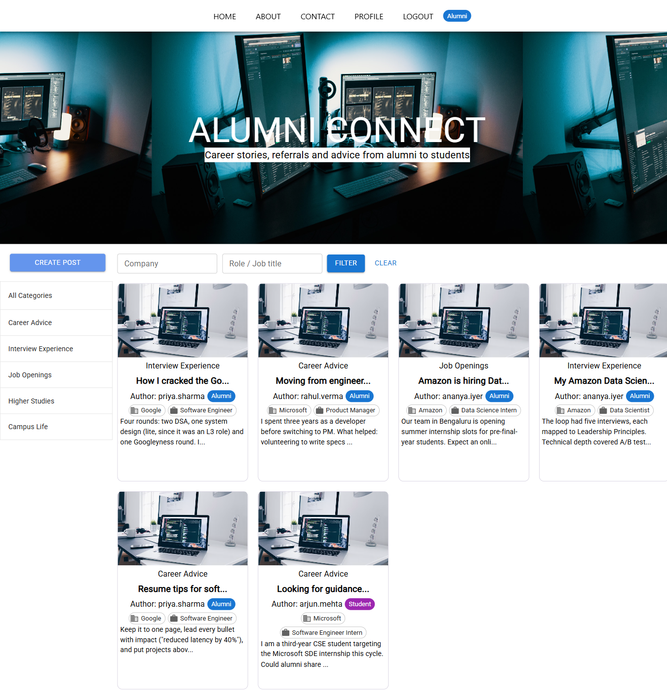
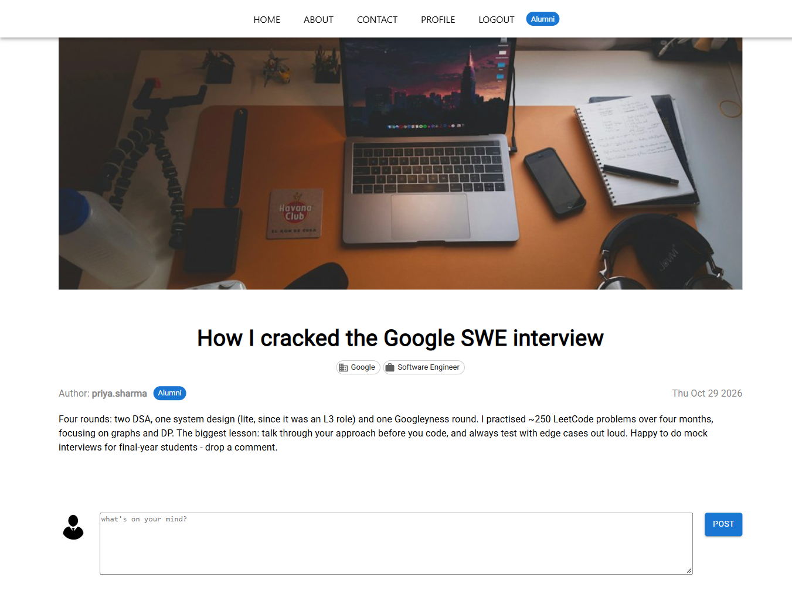
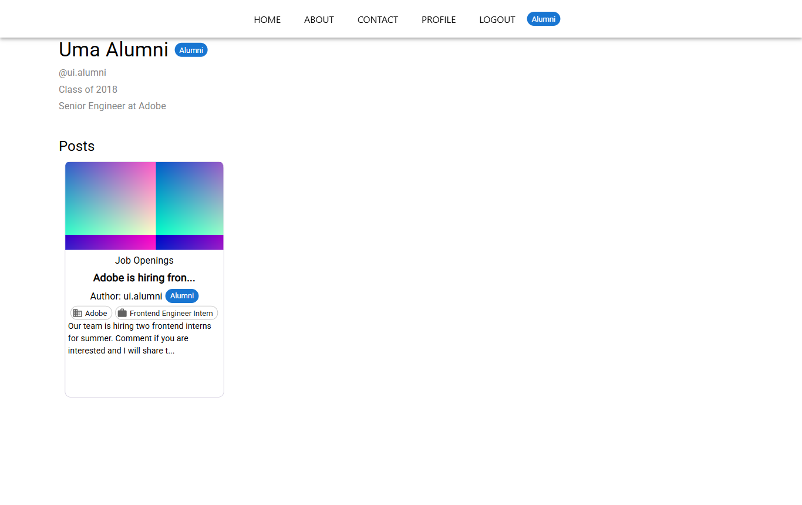

# Alumni Connect

A MERN-stack alumni platform where **alumni** share interview experiences, career advice and job openings, and **current students** browse, filter and ask questions. Every post can be tagged with the **company** and **role (job title)** it relates to.

> Full technical documentation (architecture, data models, every API endpoint, deployment walkthrough, troubleshooting): see [IMPLEMENTATION.md](IMPLEMENTATION.md).

## Screenshots

| Home feed with role badges and company/role tags | Filter by company and role |
|---|---|
|  |  |
| **Post detail** | **Alumni profile** |
|  |  |

## Features

- **Two user roles**, chosen at signup and enforced by the server:
  - `alumni` – graduation year, current company, current role/job title
  - `student` – expected graduation year
- **Role badges** (Alumni / Student) in the header, on post cards, post detail and profile pages.
- **Profile pages** (`/profile/:username`) showing role-specific details and the user's posts.
- **Company & role tags** on posts – set on create/edit, shown as chips on cards and detail pages (clickable on the detail page).
- **Filtering** by company and/or role (case-insensitive partial match), combinable with category and author.
- Categories: Career Advice, Interview Experience, Job Openings, Higher Studies, Campus Life.
- Comments and image upload (MongoDB GridFS; png/jpg/jpeg/gif/webp up to 5 MB).
- JWT authentication with automatic access-token refresh, login that survives a page refresh, and server-side logout.
- Author-only editing/deleting of posts and comments, enforced by the API (`403` otherwise).
- Idempotent **seed script** with sample alumni, students and posts.

## Tech stack

| Layer    | Tech |
|----------|------|
| Frontend | React 17, React Router 6, MUI 5, Axios (Create React App 4) |
| Backend  | Node.js, Express 4, Mongoose 6, JWT, bcrypt, Multer + GridFS |
| Database | MongoDB (MongoDB Atlas recommended) |

## Project structure

```
Blog-Website/
├── client/   React frontend
└── server/   Express API (index.js, seed.js, model/, controller/, routes/, database/, utils/)
```

## Getting started (local)

Prerequisites: Node.js 18+ (tested on Node 24), npm, a MongoDB connection string (local MongoDB or Atlas).

```bash
# 1. Backend
cd server
npm install
cp .env.example .env        # then fill in the values
npm run seed                # optional: sample users and posts
npm run dev                 # nodemon, http://localhost:8000  (or: npm start)

# 2. Frontend (new terminal)
cd client
npm install
cp .env.example .env        # optional: REACT_APP_API_URL, defaults to http://localhost:8000
npm start                   # http://localhost:3000
```

## Environment variables

**server/.env** (template: `server/.env.example`)

| Name | Required | Purpose |
|------|----------|---------|
| `MONGODB_URI` | yes* | MongoDB connection string |
| `DB_USERNAME`, `DB_PASSWORD` | only if `MONGODB_URI` is unset | Credentials for the legacy hard-coded Atlas cluster |
| `ACCESS_SECRET_KEY` | yes | JWT access-token secret |
| `REFRESH_SECRET_KEY` | yes | JWT refresh-token secret |
| `PORT` | no (default `8000`) | API port (Render sets this automatically) |
| `SERVER_URL` | yes in production | Public API URL, used to build uploaded image URLs |
| `CORS_ORIGIN` | recommended | Comma-separated allowed frontend origins (all origins if unset) |
| `SEED_PASSWORD` | no (default `Alumni@123`) | Password for seeded users |

**client/.env** (template: `client/.env.example`)

| Name | Purpose |
|------|---------|
| `REACT_APP_API_URL` | Backend base URL, baked in at build time (default `http://localhost:8000`) |
| `REACT_APP_CONTACT_EMAIL` | Email shown on the Contact page (default `alumni-office@example.com`) |

## Roles

| | Alumni | Student |
|---|---|---|
| Signup fields | name, username, password, graduation year, current company, current role | name, username, password, expected graduation year |
| Graduation year rule | must not be in the future | must not be in the past |
| Profile shows | "Class of YYYY", "Role at Company" | "Expected graduation: YYYY" |
| Can post / comment | yes | yes |

The role is stored on the user, included in the JWT payload and login response, and stamped on every post (`authorRole`) by the server from the token.

## Security model

- Access token (15 min) + refresh token (7 days, revocable via logout). On a `401` the client calls `/token` and retries the request once; if refresh fails the user is sent to the login page.
- Post author, author role and comment author always come from the token, never from the request body.
- Only the author can update/delete a post or delete a comment (`403` otherwise).
- Image upload requires login and accepts only png/jpg/jpeg/gif/webp up to 5 MB.

## Filtering posts

`GET /posts` accepts any combination of `company`, `role`, `category`, `username`:

```
GET /posts?company=google
GET /posts?role=intern
GET /posts?company=amazon&role=scientist&category=Interview%20Experience
```

In the UI, use the **Company** / **Role / Job title** filter bar on the home page, or click a tag on a post's detail page.

## Seeding

```bash
cd server
npm run seed
```

Creates 5 users (3 alumni, 2 students) and 6 tagged posts. Safe to re-run: users are matched by `username` and posts by `title`; existing records are never duplicated or overwritten. All seeded users share the password `Alumni@123` (or `SEED_PASSWORD`).

| Username | Role | Details |
|----------|------|---------|
| `priya.sharma` | alumni | 2019, Software Engineer at Google |
| `rahul.verma` | alumni | 2016, Product Manager at Microsoft |
| `ananya.iyer` | alumni | 2020, Data Scientist at Amazon |
| `arjun.mehta` | student | expected 2027 |
| `sneha.reddy` | student | expected 2026 |

## Deployment (summary)

1. **Database – MongoDB Atlas**: create a cluster, a database user, allow network access, copy the `mongodb+srv://...` URI.
2. **Backend – Render** (Web Service): root directory `server`, build `npm install`, start `npm start`. Env: `MONGODB_URI`, `ACCESS_SECRET_KEY`, `REFRESH_SECRET_KEY`, `SERVER_URL` (the Render URL), `CORS_ORIGIN` (the frontend URL). Optionally run `npm run seed` once from the Render shell.
3. **Frontend – Vercel or Netlify**: root directory `client`, build `npm run build`, output `build`. Env: `REACT_APP_API_URL` (the Render URL), optionally `REACT_APP_CONTACT_EMAIL`. The build compiles cleanly with `CI=true`. SPA rewrites are included (`client/vercel.json`, `client/public/_redirects`).
4. Update `CORS_ORIGIN` on the backend with the final frontend URL.

Step-by-step instructions: [IMPLEMENTATION.md – Deployment](IMPLEMENTATION.md#13-deployment-guide).

## Scripts

| Location | Command | Description |
|----------|---------|-------------|
| server | `npm start` | Start API with node |
| server | `npm run dev` | Start API with nodemon |
| server | `npm run seed` | Insert sample data (idempotent) |
| client | `npm start` | Dev server on port 3000 |
| client | `npm run build` | Production build into `client/build` |

## Testing status

Verified against a local in-memory MongoDB with dummy secrets: 45/45 API checks (including non-author edit/delete → 403, unauthenticated upload → 401, wrong file type → 400) and a 28-step headed Chrome (Playwright) walkthrough of signup, login, filters, create/edit/delete, profile, refresh persistence, token refresh and contact page. Details in [IMPLEMENTATION.md §14](IMPLEMENTATION.md#14-verification-steps-and-results).
